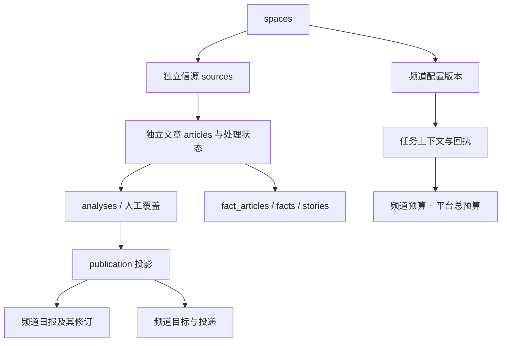

# ADR 0001：共享应用中的独立业务频道

日期：2026-10-23 · 状态：DEV-03～DEV-05 处理、公开阅读及独立报告/通知/配额已实现；实际验收见各阶段验证记录。

代码基线：`b3998dc6fc138eb9659f33f55eb38c1c716f0d57`。关联：[开发计划](../development-plan.md)、[架构约定](../architecture.md)。本文保留完整目标契约；DEV-03～DEV-05 已接入频道配置、处理任务、网站与公开入口、独立报告、通知和配额，具体已实现范围以[频道开发说明](../multi-space-development.md)及 [DEV-05 验证记录](../reports/2026-10-23-dev05.md)为准。公开接口版本为 4.1.0；评审确认的 [7 项已知问题](../known-issues.md)仍待后续版本修复，目标契约不代表所有边界已满足。未运行生产迁移或启用真实模型、通知。

## 1. 背景与决策

用户已确认统一网站切换业务主题，各主题的规则、日报与推送独立；网络安全先上线，出海政策和 3C 硬件随后接入。站名、品牌、子分类、正式信源、预算与通知接收方仍由用户或业务负责人决定。

采用共享 Web/API/worker、共享数据库服务的多频道应用。以 **`space_id`** 表示业务频道的稳定身份；保留上游 `channel` 的资讯/X 内容形态含义，保留 topic 的标签/主体专题含义。`space_id` 是本公司应用的业务边界，不宣称形成完整多租户 SaaS 的客户级安全隔离。

首版采用**频道内独立信源记录、文章和处理状态**：同一 URL 同时属于两个频道时，产生不同 article ID，分别评分、分类、写作、归组、发布和撤回。频道内继续去重。跨频道共享抓取、正文和模型产物后置；不能通过共享文章状态，使一个频道的 BLOCK 或人工改分影响另一个频道。

选择理由：现有文章拥有一组 `processing_*` / `grouping_*` 状态；`publications` 以 `article_id` 为主键；人工覆盖和归组覆盖也按文章记录。独立文章保留这些关系，避免首版同时拆成共享原文、一对多分析、多发布投影和多套处理状态。代价是跨频道重复存储、抓取和模型调用，先通过配额限制；需要共享时再引入独立原始资料实体，而不是修改频道内业务身份。

## 2. 改造前的基线

| 范围 | 基线事实与定位 | 与目标的差距 |
| --- | --- | --- |
| 分类与专题 | [taxonomy.ts](../../industry/taxonomy.ts) 提供单套分类；[topics.ts](../../packages/backend/src/publication/topics.ts) 启动时读取单份 `industry/topics.json`，按标签/主体匹配 | 专题是同一精选池的阅读视图，没有独立分析规则 |
| 内容形态 | [contracts/taxonomy.ts](../../packages/contracts/src/taxonomy.ts) 定义 `all/news/x/firstParty` 筛选；数据库 publication 的 `channel` 只存 `news/x` | 不能把网络安全等业务频道塞入原字段 |
| 资料身份 | [0001_core.sql](../../database/migrations/0001_core.sql) 中 `articles.identity_key` 全局唯一；[materials.ts](../../packages/backend/src/content/materials.ts) 根据 URL、X 身份或来源回退键判重 | 同一原文在两个频道目前会共享文章 |
| 当前结果 | [publish.ts](../../packages/backend/src/publication/publish.ts) 按 article ID 取最新分析和人工覆盖，`ON CONFLICT(article_id)` 更新 publication | 仅加 source↔space 映射不能隔离结果 |
| 报告 | [0002_events_reports.sql](../../database/migrations/0002_events_reports.sql) 与 [compose.ts](../../packages/backend/src/reports/compose.ts) 使用 `(kind,key)` | 同日多个频道会竞争同一份报告 |
| 通知 | [selected.ts](../../packages/backend/src/notify/selected.ts) 不传 targetKey；[deliver.ts](../../packages/backend/src/notify/deliver.ts) 遍历启用的 content targets | 默认主群/镜像群是相同内容分发，不是按频道订阅 |
| 费用 | [receipts.ts](../../packages/backend/src/providers/receipts.ts) 按 service 加锁并从 receipt_attempts 计算次数 | 没有频道额度及频道成本归属 |
| 配置与缓存 | [prompts.ts](../../packages/backend/src/editorial/prompts.ts)、[models.ts](../../packages/backend/src/editorial/models.ts)、[reports.ts](../../packages/backend/src/publication/reports.ts) 使用单站配置和进程内缓存 | 不能并发切换全局 industry/site 或复用未区分频道的缓存 |

`topics` 历史数据库表已经由 [0045_drop_topics.sql](../../database/migrations/0045_drop_topics.sql) 删除。以下目标模型不假定它仍存在。历史 monitor/leaderboard 表也不作为多频道改造的依据；应以完整迁移结果确定现存对象。

## 3. 目标数据契约

### 3.1 身份、关系与边界

新增频道登记 `spaces`，至少表达稳定 `id`、唯一且稳定的 URL `slug`、启用状态和当前配置版本。频道配置快照以 `(space_id, config_version)` 唯一，保存可重建的非秘密配置及内容指纹；凭证只引用受控 Secret，不放入配置快照、任务或模型请求。

现有业务主键继续全局唯一：source ID、article ID、story/fact/report/analysis/receipt ID 不改成只在频道内唯一。这样尽量保留已有引用和 URL；在需要同频道外键的父表增加 `UNIQUE(space_id,id)`。业务自然键单独限定频道范围。

图中同一条业务链必须属于同一 space。**持有全局唯一 ID 不代表有权跨频道读取或写入**：入口解析上下文，服务层检查归属，数据库约束阻止错误关联。首版保持全局管理员模型；如以后引入频道管理员，再增加成员授权。公司资产与处置数据始终通过独立受保护接口访问，不进入公开 publication。

### 3.2 唯一约束与同频道外键

下表是完整目标约束。DEV-03 已实现配置、来源/文章/分析、事件、publication 及回执相关迁移；翻译/人工覆盖的独立频道入口、报告、通知及配额仍待后续实现，不为未实现的写入路径增加空置字段。全局主键如 `articles(id)`、`reports(id)`保留。

| 对象 | 目标唯一性 | 必须满足的同频道关系 |
| --- | --- | --- |
| spaces / 配置版本 | `spaces(id)`、`spaces(slug)`；版本 `(space_id,config_version)` | 激活版本属于对应 space；初建后再激活，避免循环初始化 |
| sources | 保留全局 `id`；增加 `(space_id,id)` 唯一键 | `space_id → spaces`；来源配置、tier、participation_mode、cursor 属于该频道 |
| articles | 保留全局 `id`；新增 `(space_id,id)`、`(space_id,identity_key)` | `(space_id,source_id) → sources(space_id,id)` |
| article_discoveries | 保留 `(article_id,source_id,via)` 去重，可增加space供查询 | article 和 source 都必须属于同一space；禁止跨频道发现记录触发来源所有权切换 |
| analyses / overrides / translations | 保留全局analysis ID或按article的原主键；增加需要引用的scope唯一键 | 所属article同频道；publication引用的analysis还必须属于同一article，不能只验证同频道 |
| facts / stories / 关系表 | 全局ID保留；相同原始事件可在不同频道各有一份；自然公共标识生成逻辑必须审查 | fact→story、story合并/别名/关联的两端、fact_articles的两端、story_signals的文章与来源均同频道 |
| publications / selected_state | 保留 `article_id` 单行语义，增加space列和索引 | article、source、analysis、fact/story关联同频道；不接受其他频道的手工指定ID |
| reports | `(space_id,kind,key)` 取代 `(kind,key)`；report ID及修订主键保留 | report_revisions跟随report；content JSON中的文章/事件引用在写入及读取时验证同频道 |
| notify_targets / deliveries | target key继续全局唯一，频道目标增加 `(space_id,key)`；现有 `(target_key,dedupe_key)`继续防重复 | 频道投递 `(space_id,target_key)` 指向同频道目标；payload引用内容同频道 |
| receipts / receipt_attempts | 保留全局ID和logical_key；attempt仍 `(receipt_id,attempt)`唯一 | 频道调用的receipt与attempt同space；平台调用显式标记，不伪装成默认频道 |
| 频道设置 / 频道预算 | 新增 `space_settings(space_id,key)`、`space_budgets(space_id,service)` | 不改变现有平台 `settings(key)` 和 `budgets(service)` 的身份 |

保留现有 `identityKeyFor` 的 URL 归一化、X tweetId 和来源回退规则；只改变其唯一范围。禁止把频道名简单拼接进未规范化 URL 后另造一套判重。独立source ID由平台生成或按频道确定性命名，用户可见信源名可重复。频道内多个来源发现同一资料仍复用现有 discovery/provenance 规则，但搜索和重归属只能在当前频道进行。

频道编辑独立与来源事实联动必须区分：A频道的人工不推荐或编辑性撤回不改变B；原始发布者修订/撤回、全文许可失效等来源事实则应找到受影响的各频道副本，分别投递有scope的更新/失效任务并留下审计。不能因为记录独立就继续公开已失效的来源内容，也不能把某频道的偏好更正当成全站来源撤回。

关系表增加 `space_id` 后，以复合外键分别验证两端。例如 `fact_articles(space_id,fact_id)` 与 `(space_id,article_id)` 分别引用父表；stories的`merged_into`、story_links两端也遵循此规则。不能仅以应用层WHERE代替能表达的关系约束。

现有 `analyses.receipt_ids`、`story_digests.article_ids` 是数组，reports内容和部分grouping数据是JSON，delivery的subject是多态文本；这些字段**没有可直接补上的普通外键**。首版必须在同一写事务中批量验证引用的space，并做负例测试；读取旧内容时再次按当前频道/撤回权限过滤。若后续需要数据库级完整引用约束，再引入相应关联表并独立迁移，不能在ADR中把数组/JSON检查宣称为外键保障。

平台运维的receipt、job_run、告警目标可能没有space。可使用显式平台scope的写入函数；频道函数必须拒绝空space。保留全局target-key外键，同时用非空space复合外键保护频道投递。只有经过登记的平台用途才允许空space；`purpose='content'` 的目标及投递必须有space。跨频道的聚合运维视图单独提供，不能通过省略space让普通查询自动变成全库查询。

### 3.3 影响矩阵

| 范围 | 必须调整的持久化／行为 | 优先复用 |
| --- | --- | --- |
| source | 独立配置、tier、启停、许可、轮询与增量cursor；后台操作、采集队列、外部ingest验证space；导入示例源不得隐式覆盖安全频道 | `sources/`、`ingest/items.ts`、`content/materials.ts` |
| article | scope内identity_key去重；revision、discovery、source provenance、正文/媒体与翻译均随文章归属；不跨频道自动换source | `content/` 的归一化、修订、许可逻辑 |
| processing | 当前状态在articles上的事实保留；增加配置版本/执行代次；队列、恢复、人工重评、grouping状态及错误均限space | `jobs/content.ts` 的重试/恢复与事务入队 |
| publication | scope列贯穿publish、人工更正、撤回、搜索、精选席位、ledger与所有公开出口；只有该频道当前有效分析可更新投影 | `publication/scope.ts` 统一规则与publish事务 |
| story | recall、词法/向量候选、合并、事实关联、热榜、综述和缓存按space；全局ID不等于可以全库召回 | `events/`、`embeddings`、grouping_decisions/overrides |
| report | 独立出刊时间、选文窗口、分类、报告键、修订、补刊及缺期告警；保留历史报告当期内容及当前撤回语义 | `reports/compose.ts`、`edition.ts`、`publication/reports.ts` |
| delivery | target归属、发送前复核、标题租约、去重键、人工重发和审计带space；同一物理群可有不同频道target，必须由明确配置允许 | `notify/deliver.ts` 的投递状态与unknown处理 |
| receipt | 调用身份包含space和会影响结果的配置；模型/来源付费调用归属明确；recovery解析subject不可丢space | `providers/receipts.ts`、`llm.ts`、现有实际attempt记录 |
| budget | 平台总上限保留；频道额度独立、同事务检查；每次实际请求（含重试）计数；用量与成本区分 | 现有service锁与receipt_attempts计数 |
| settings | 平台基础设施/凭证/备份保持全局；行业模型覆盖、规则、出刊与运营配置归space并可追踪版本 | 现有审计、settings读取模式 |
| cache | 按space/config/查询/内容revision组织缓存与失效；禁止匿名相同URL因Cookie切换内容；浏览器收藏/已读/搜索带space | `lib/cache.ts`、HTTP ETag、local-state的兼容导入 |
| audit / modules / files | 频道业务审计与模块hook/任务带space；平台任务显式全局；私有附件受保护；分享图/derived cache包含频道与配置身份 | 现有模块接口、审计、存储/保留期能力 |

安全通知不直接继承新闻的“早于target启用时间不推送”语义；首次发现存量重大风险和后续证据修订的通知规则由SEC-03定义。DEV-02只固定scope与复用边界，不提前新增并行outbox，也不宣称消息端到端绝对不重复。

## 4. 显式上下文、版本与任务

### 4.1 配置解析

拟采用不可变上下文：`SpaceContext { spaceId, configVersion }`。`spaceId`解析后必须存在且允许当前操作；`configVersion`必须属于该space。任务载荷不传任意提示词路径或环境变量。稳定平台品牌仍可以全局配置；分类、专题、提示词、门槛、模型路由及报告文案通过频道配置解析。

当前静态`CategoryKey`等类型由单套industry推导，改造时需要频道运行时schema校验及明确的配置类型，不能靠类型断言接受其他频道分类。配置信息依然可以版本化文件维护，首版无需配置编辑器；必须保存可读取的历史版本或其构建产物，不能只记录一个已经无法还原的hash。

禁止修改进程全局SITE、prompt目录、TOPICS、模型缓存来临时切换频道。共享纯函数可保留；有领域配置的函数显式接受context或已解析的不可变配置。缓存key至少区分space/configVersion；API请求入口、worker任务入口和管理端写入入口使用同一解析器。

### 4.2 执行与结果身份

频道任务至少记录space、业务对象ID、输入revision和配置version；处理结果记录实际prompt/rule版本、model标识、receipt、执行代次和结果。provider返回的request_id是可选供应商事实，不用虚构值填满；本地任务ID、receipt ID与供应商request_id分别保存。

新任务使用当前激活配置；已排队任务使用所携带且仍可读取的版本。修改配置默认影响后续工作，不自动重评全部历史。显式重评生成新执行代次；落库以文章input revision、期望config version和执行代次做比较更新，防止旧任务最后完成反而覆盖新结果。任务遇到缺失版本或space不匹配时失败并可观察，不能回落到其他频道或“最新”配置重放。

pg-boss基础设施可以共享。内容任务载荷携带context，singletonKey对业务对象、版本与重评语义保持稳定；文章ID全局唯一仍不能替代context验证。报告、定时任务、去重租约等没有全局文章ID保护的键必须包含space。调度器按启用频道生成任务，保留单worker首发约束；停用频道后清理其待执行调度，但保留运行审计。恢复路径与首次运行使用相同scope规则。

模型回执目前已哈希system/user/prompt等输入，因此不同提示词通常生成不同logical_key；这不等于已有频道归属。目标logical identity增加space、配置版本及真正影响输出的模型/输入配置，同一频道同一逻辑重试继续复用回执。不要每次生成随机版本导致重复付费。跨频道相同prompt也先分别归属，不在本期实现共享调用及分摊。

### 4.3 预算及同步游标

保留全局service预算硬上限；在同一事务内按固定顺序取得平台service锁、频道service锁，检查平台总使用量和频道使用量，再登记attempt。频道耗尽仅阻断该频道的普通模型/采集调用；全局耗尽仍阻断全部相关调用。安全预留额度不是自动产生：正式额度由负责人配置，必须使其他频道可分配额度不侵占已保留部分。预算仍以当前请求次数为基础；金额估算与实际费用不混为硬额度。

selected_ledger可以保留全局递增seq及提交顺序锁，新增space过滤、按space维护epoch；不要求首版改成多套序列。snapshot/changes cursor必须绑定space、epoch和查询语义，拿A频道cursor请求B频道返回`409 snapshot_required`。若保留旧格式，只有默认频道的明确兼容解析器可接受；其他频道拒绝。数据回填/重建后的旧cursor处理在迁移演练中确认，不声称跨版本游标天然有效。

## 5. URL、API与旧单站兼容

以下为 DEV-04 已实现契约，OpenAPI、MCP说明、链接生成与测试同步更新。路径 slug 只做身份定位，不承担授权。DEV-05 已开放非默认频道报告，各频道独立归档、推送与配额。

| 入口 | 新频道范围 | 旧入口行为 |
| --- | --- | --- |
| 网站 | `/channels/:slug/...`，文章/事件/专题/报告在同一scope下；统一导航切换 | 旧首页及集合页固定对应默认频道，可读兼容；新导航生成显式路径 |
| 网站API | `/api/site/spaces/:slug/...` | 现有 `/api/site/...` 由兼容适配层显式注入默认space |
| 公开API/Markdown | `/api/v1/spaces/:slug/...`，返回的内容链接带频道 | 现有 `/api/v1/...` 继续只读默认频道，不变成全频道汇总 |
| RSS | `/channels/:slug/feed...`，保留精选/分类/报告等功能 | 原 `/feed...` 固定默认频道，保持现有订阅可读 |
| MCP | `/api/mcp/spaces/:slug` 独立 transport；所有工具使用端点频道 | 原MCP入口绑定默认频道；不将未传space解释成全库 |
| 后台/外部摄取 | 显式space路径或必填context；先认证，再校验对象归属 | 原有单站适配仅在兼容入口可用；不能让未知space自动落入默认频道 |

MCP 采用独立 transport 路径。API 注册适配器解析频道后，通过 `AsyncLocalStorage` 在同一请求内传递已解析的配置与频道；读取层 SQL、缓存键、游标和链接均读取该上下文。原地址同样载入默认频道的活动快照，保留旧链接形式。前端 SSR 按请求 URL 读取 API，不共享可变频道变量。

旧无频道详情URL只允许读取默认频道中的对象；收到其他频道ID不自动跨频道跳转，返回404。默认频道的既有分享链接可保留200兼容页并设置显式canonical；不强制API/RSS客户端跟随重定向。原来的 `/topics/:slug` 仍表示默认频道的标签专题，不重解释成业务频道。

默认频道ID在初始化或迁移时显式登记且之后稳定。已有单站数据先整体归入保留原配置的默认频道，不因为首发方向是安全就把既有AI资料重命名为安全数据。全新安装可明确以安全频道为默认，但不导入AI示例源。仅启用且有活动配置的频道显示入口；本版没有单独的隐藏预览状态，第二频道隔离验收使用独立测试数据库。

浏览器外观、字体可以跨频道共享；收藏、已读、搜索历史、反馈草稿等内容状态携带space。旧本地数据迁入默认频道，保留原ID和导入/导出可读性，不直接删除旧storage key。频道选择只决定导航目的地；公开可缓存内容由显式URL决定，不能让同一URL按Cookie返回不同频道。

## 6. 迁移、回填与发布

DEV-03 已新增单语句迁移和显式 `space-cutover.ts`。实际桥接采用常量 `space_id NOT NULL DEFAULT 'default'`，利用 PostgreSQL 常量默认值机制归属原单站数据，不做逐行大批量 UPDATE。旧分析的空配置仅由默认频道初始代次兼容；其他频道必须有登记的版本。以下表格保留完整目标阶段，报告/通知/配额已纳入 DEV-05；真实备份副本演练仍未完成。

| 阶段 | 操作 | 允许退出的条件 |
| --- | --- | --- |
| A：清点与快照 | 记录实际表、约束名、对象行数、数据分布、旧游标、所有队列及配置；备份数据库和业务文件；确定默认频道归属 | 有恢复记录；不能从仓库样例推断生产数据量或字段分布 |
| B：扩展结构 | DEV-03 新建spaces/版本；初始化默认频道，逐表以常量默认值增加space列及单独版本列；创建scope唯一索引及待验证外键。DEV-05增加报告、通知、译文归属与频道配额 | 新增数据归属明确；初始化不覆盖已激活版本、不导入示例信源 |
| C：桥接版本与旧数据 | 默认频道兼容旧无scope任务及初始代次的旧分析；新写显式携带context；检查父子关系、行数与内容。若后续迁移需要大量回填，另行按主键分批执行，不进入发布DDL | 默认频道新写不漏scope；旧数据数量和内容校验一致；迁移不触发模型、公开重发或通知 |
| D：约束验证与scoped读写 | 验证复合FK；NOT NULL语义先用CHECK NOT VALID再验证；所有引擎/模块读写、恢复、缓存与出口转为context；在排空旧worker后切换任务载荷 | 默认单站完整回归；无可执行的旧无scope任务；不存在跨频道关系 |
| E：切换自然键 | 先建 `(space_id,identity_key)` / `(space_id,kind,key)` 等唯一索引；新代码使用对应冲突目标；确认无旧写入方后删除旧全局自然键约束 | 同URL/同日期可在双频道独立存在；global article/report ID不变；重试仍正确去重 |
| F：双频道试验与激活 | 在独立测试库启用第二频道验证全部行为；shadow期不发外部通知；依次启用安全采集、模型和授权通知 | DEV-03～DEV-05验收通过、业务输入和费用范围明确后才能进入正式试点 |

新迁移必须一文件一条允许的在线语句，索引 `CONCURRENTLY IF NOT EXISTS`；新增FK/CHECK先`NOT VALID`再单独验证。大量UPDATE不进入发布迁移，也不改写历史SQL。新registry的种子数据由受控初始化步骤写入，不用DO或其他形式绕过迁移检查。约束删除使用已验证的实际名称、无CASCADE、限定锁等待；新旧冲突目标切换须按阶段部署，不能只建立新索引就认为旧全局约束失效。[迁移检查器](../../scripts/migration-safety.ts)

DEV-03 的业务scope列不允许NULL；平台回执允许成对的空scope/config，频道回执必须成对且属于登记版本。新频道相关写入显式传context，旧单站调用只在定义过的默认入口兼容。FK验证无法检测JSON/数组里的跨频道引用，另运行引用一致性检查和应用负例测试。

已有单站无scope队列不能按“当前用户选中的频道”推断。先停止排程、排空或按明确旧默认频道规则转换待运行任务，记录数量；再启动新worker。旧版API/worker不能和已启用多频道数据长期混跑。

## 7. 回退边界

1. **扩展结构、尚未写入第二频道时**：旧版本回退仍需验证其新增写入是否被默认归属适配覆盖，以及新增约束是否会拒绝旧写法。保留新增列/表通常比破坏性down migration安全；不执行通用“删除space列”回退。
2. **scoped桥接版本已运行、第二频道未激活时**：优先回退到上一经过验证的scoped版本；清理缓存，恢复明确的默认频道路由。保留历史配置版本、审计和回执，避免恢复后重复付费或重发。
3. **第二频道开始写入或旧全局唯一约束删除后**：不能只回滚镜像到未改造的 `b3998dc6`；其无scope查询会混读多频道数据，且无法重新建立旧自然键唯一性。先停新业务/通知、保留证据并回退到scoped兼容版本；若必须恢复旧单站，使用切换前数据库与业务文件备份，明确RPO及切换后数据的导出/重放方案。
4. **通知与付费调用**：数据库恢复不能撤回已发送消息或已计费请求。恢复后先核对sent/unknown/attempt记录，继续沿用“不盲重发unknown”的规则。上线前演练此处，不能用数据库恢复成功代替外部副作用核对。

## 8. 替代方案与后续演进

同一GKE集群部署多套AIHOT可以复用上游单站机制，但需要各自数据库/worker/配置/目录/群目标，统一入口只是跨站导航。用户已要求共享网站和频道能力，所以它仅作为时间或风险无法接受时的比较方案，不作为本次交付。

共享一篇article再添加多个topic不能满足独立规则；共享原文加多套channel_article则长期可行，但会立即涉及分析、处理状态、publication、归组和成本归属拆分，故后置。将来可以新增全局raw_material，频道文章只引用原始证据且仍独立拥有业务状态；共享产物不得绕过各频道的许可、数据边界或预算归属。

## 9. 验收边界

DEV-02隔离原型位于 [experiments/multi-space](../../experiments/multi-space/README.md)，使用专用随机schema和合成样本，与生产迁移及引擎分开。它可以证明：同URL在两个space独立存在、同频道去重、关系外键拒绝跨频道引用、版本化context不串用，以及简化报告/通知路由的领域契约。原型的 `(space_id,canonical_url)` 是生产 `(space_id,identity_key)` 的URL子集，不取代X身份和来源回退判重。原型的 `request_id` 是本地确定性逻辑请求标识，不是供应商返回的request_id；接入现有receipt时必须保持两者区分。

原型**不证明**现有采集器、LLM/回执、归组、公开出口、缓存、调度恢复、真实飞书、完整预算和生产迁移已经改造完成。测试实际覆盖项及结果以该目录README/测试输出为准，不用原型表名暗示生产表已存在。本ADR完成不等于DEV-03～DEV-05或M1全部退出条件通过。

后续引擎验收至少包含：

- 同URL在A/B频道生成不同article ID；同频道重复摄取复用；A的BLOCK、编辑性撤回、人工改分不改变B；来源事实修订/撤回则正确联动所有受影响副本。
- 伪造source/article/fact/story/report/target ID不能跨频道关联或读取；数组和JSON引用负例也被拒绝。
- A/B同日期生成两份报告；A没有候选不影响B补刊；旧报告修订与撤回保持当前语义。
- 相同标题不因全局租约挡住另一频道；target只收到授权频道；failed/unknown重发路径重新核对scope。
- 旧任务延迟完成不覆盖新输入/配置代次；重启与receipt恢复仍进入原space；未知space或配置版本不能降级。
- A频道预算耗尽B可继续，平台总上限仍生效；并发attempt不超卖；不经LLM的安全证据链不因模型预算停止。
- 网页、详情、搜索、专题、RSS、API、MCP、Markdown、OG、sitemap、cursor、服务器/浏览器缓存均通过交叉请求测试；内部资产始终不在公开出口。
- 从真实单站备份副本升级：行数/归属/约束/引用检查通过，旧URL和本地阅读状态可读；回填无误推；切换和恢复步骤可复现。

## 10. 实施次序与排期影响

DEV-03先交付context/配置和scoped数据桥接，再做采集、分析、归组与恢复；DEV-04覆盖全部读出口和缓存；DEV-05完成报告/通知/预算。基础契约稳定后后两项可以部分并行，但不能先开放第二频道再补数据库范围。

维持开发计划中M2的22–35人日为当前粗估；本次原型仅验证领域隔离，不足以下调工期。DEV-03开始前单独估算迁移清单、89个直接引用industry/site的文件的实际分层、JSON引用校验及回执恢复改造；该文件数含可保留的全局站点配置，不等于89个文件都必须重写。若需要跨频道原文共享、细粒度权限或大规模存量迁移，作为新增范围估算。DEV-02之后仍需完成安全证据入口、通知语义复用和GKE依赖验证，不能将ADR与小原型视为整个安全平台设计完成。
