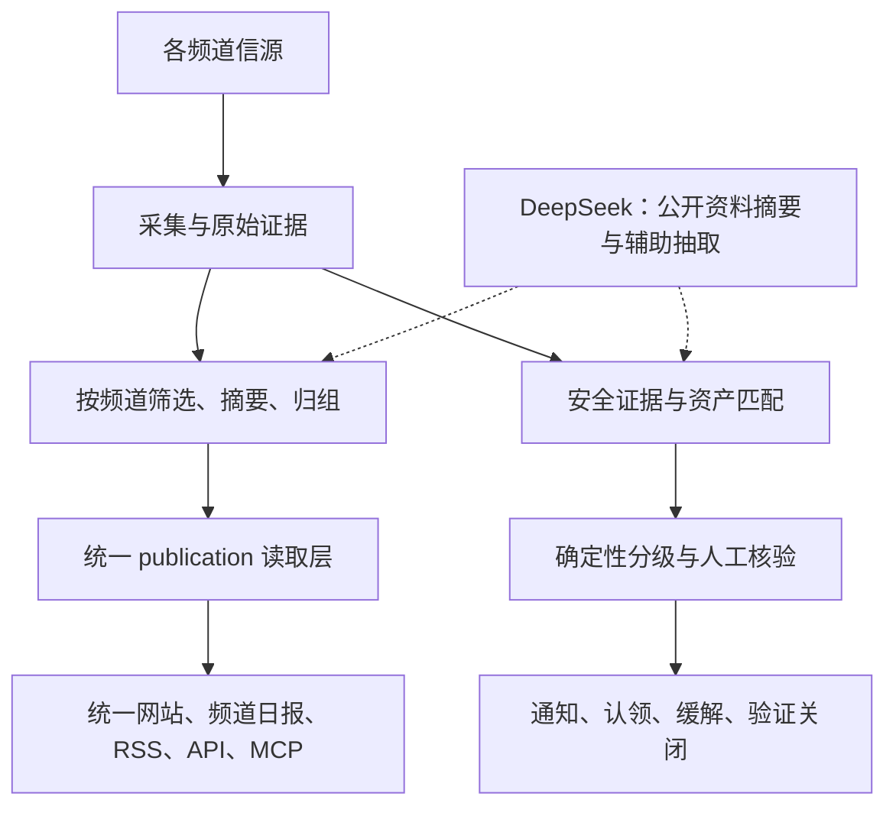

# 多主题情报与漏洞响应平台开发计划

日期：2026-10-27（Asia/Shanghai） · 文档版本：v0.8 · 项目版本：4.2.0 · 公开接口版本：4.1.0 · 状态：DEV-01～DEV-05 与双频道运营准备已实现；四项问题已修复，三项仍待修。安全配置未校准，本地验证不等于业务验收，安全业务及云端部署仍待后续阶段。

最新交付：[DEV-05 验证记录](reports/2026-10-23-dev05.md)、[DEV-04 验证记录](reports/2026-10-23-dev04.md)、[频道配置与迁移说明](multi-space-development.md)、[多频道 ADR](adr/0001-multi-space.md)。DEV-05 增加频道独立报告、推送、翻译和配额；M1 其他风险验证仍待完成。此前记录见 [DEV-03](reports/2026-10-23-dev03.md)、[DEV-01 / DEV-02](reports/2026-10-23-dev01-dev02.md)。

本计划基于仓库 `b3998dc6fc138eb9659f33f55eb38c1c716f0d57`，以当前代码、已有部署研究及用户确认的范围为依据。本文中的阶段、模型配置、信源和指标是交付建议；真实云资源、消息接收方和费用预算尚未配置。

后续按[独立维护约定](fork-maintenance.md)开发，不再以向原项目贡献为目标。本项目版本与变更进入 [CHANGELOG.md](../CHANGELOG.md)，站点日志单独维护；上游只保留来源及可选补丁参考。

## 1. 已确定的目标与首版范围

用户已确认：

- 本项目独立维护需求、修复、版本和更新日志，不再贡献原项目。
- **统一网站提供多个业务主题**，每个主题独立设置筛选规则、日报和推送。
- **网络安全先上线**，出海政策、3C 硬件随后接入。
- 部署方向为 GCP Kubernetes / GKE，模型优先接入 DeepSeek。

本文将业务主题称为“频道”，与上游已有的标签/公司主题页区分。技术字段暂用 `space_id` 表示频道上下文，避免与现有内容类型字段 `channel` 混用；具体契约在 M1 固定。

首版交付：统一网站与频道底座、网络安全情报、公司资产影响核验、分级通知、认领及处置记录、GKE 内部试点。生产只启用安全频道，测试环境必须启用第二个频道，验证独立性。首版无需制作出海政策和 3C 的正式内容，也不包含自动修复、主动漏洞利用验证、全量云资产发现、复杂租户计费或移动 App。

“及时响应”指尽快发现已披露的风险并关联公司资产；不能保证提前发现尚未公开的 0day，也不能把新 CVE、公开 PoC、高分漏洞、在野利用和无补丁视为同一种状态。

## 2. 当前基线与差距

| 范围 | 当前状态 | 本计划要补齐的内容 |
| --- | --- | --- |
| 开发仓库 | 独立维护，以 `main` 为开发与部署基线，首个开发基线为 `b0ea3ed` | 从 `main` 新建开发分支，经 PR 评审合并；按需选择并验证上游补丁，不默认同步版本 |
| 本地验证 | DEV-05 类型检查、完整回归、Web 构建及 smoke/MCP 结果见最新验证记录 | 后续业务变更的行为测试及 staging 验证 |
| 采集与阅读 | DEV-03～05 已实现频道配置、处理/读取/报告/推送/配额隔离；旧地址固定默认频道 | 正式配置、信源和业务验收 |
| DeepSeek | 已有模型预设与 OpenAI 兼容调用链；未配置真实 Key | 结构化结果评测、预算、失败处理及真实小样本验证 |
| 安全业务 | 已研究官方信源，未接入生产 | 证据修订、版本匹配、资产影响、处置和安全通知 |
| 运行环境 | 项目内 PostgreSQL 17 已运行，开发库迁移及三个应用进程启动/停止已验证；Docker 未启动 | GKE 配置、云端迁移和恢复演练 |

上游主题页读取单份 `industry/topics.json`，提示词读取单套 `industry/prompts/`，上游报告按 `(kind, key)` 唯一；本 fork 已扩展为 `(space_id, kind, key)`，需显式切换旧约束。给导航加三个入口无法满足独立规则和日报要求。参考：[主题读取](../packages/backend/src/publication/topics.ts)、[提示词](../packages/backend/src/editorial/prompts.ts)、[报告](../packages/backend/src/reports/compose.ts)。

## 3. 架构与实现边界

### 3.1 多频道底座

共享代码、部署、数据库服务和队列基础设施；每个频道独立拥有信源关联、分类词表、提示词、评分结果、精选状态、事件、报告、推送目标和用量记录。

首版优先使用**频道内独立内容记录和处理状态**，接受同一原文在两个频道各存一份，减少一次性拆分现有所有业务实体的风险。频道内继续判重，判重键及相关唯一约束必须携带频道范围。跨频道只存一份原文、共享模型产物等优化后置，不能先共享文章状态而导致一个频道的 BLOCK、撤回或人工改分影响另一个。

M1 形成数据关系和迁移 ADR，逐项核对 source、article、processing、publication、story、report、delivery、receipt、settings、cache；不能把增加一个 `space_id` 列当作改造完成。规则版本、模型版本和输入修订写入处理记录；任务、模型回执及缓存键纳入会影响结果的频道配置。

- 公开内容继续从 `publication/` 读取，并保留全文许可、来源撤回、修订和缓存失效语义。
- 频道需要覆盖网页、搜索、RSS、API、MCP、Markdown、分享图、站点地图及浏览器本地状态，不能仅改首页。
- 频道相关任务显式携带上下文；未知或缺失频道应拒绝处理或使用经过定义的单站兼容入口，不能静默跨频道读取。
- 使用显式频道路径/参数及频道配置缓存；不能通过修改进程全局变量切换行业包，也不能让同一可缓存匿名 URL 随 Cookie 返回不同频道内容。
- 首版保留全局预算熔断，并增加频道用量和配额约束；一个普通频道耗尽自身额度不应消耗安全频道保留的配额，全局熔断仍是硬上限。
- 原有单站数据的归属、回填和旧 URL 行为在迁移方案里写清。无需提前构建面向所有客户的通用多租户 SaaS。

### 3.2 安全响应模块

优先新增 `modules/security-intel/`，利用现有 HTTP、队列、调度、模型步骤、告警及迁移扩展接口。频道能力涉及共享引擎的地方做最小通用改造，漏洞字段、资产和处置规则留在模块中。[模块约定](architecture.md#模块)

两条流程各自运行：新闻流程负责阅读与摘要；安全流程在**证据持久化之后、新闻预筛之前**进入漏洞核验与资产匹配，不等待 LLM、精选、热点或日报。当前 `articleChanged` 是公开内容变化 hook，不能单独作为完整安全入口；M1 决定采用模块自有摄取流程还是补充通用入库事件，并验证事务边界。

安全模块最小数据范围：公告与来源快照、CVE/GHSA 等别名、受影响范围及修复版本、证据修订、资产组件与版本、影响判断、处置记录、通知投递及审计。每项判断关联来源和版本；“未知”“未确认受影响”“确定不受影响”保持区分。

- 首批按实际资产选择 **6–10 个官方源**，优先评估 GCP/GKE、Kubernetes、CISA KEV、GHSA 及实际使用的系统/运行时公告。既有 35 源目录是候选池，不是全部接入承诺；上线前重测端点与授权条件。
- 普通 RSS/Atom 复用现有采集器；KEV/GHSA/OSV 等结构化接口按用途分期，OSV 用于支持生态的包版本核验。保存增量游标、修改时间、来源 URL 和原始修订依据。
- 首批导入 **10–20 个实际服务**及其组件、版本、暴露面、负责人、证据时间。只对已经验证的生态执行自动范围匹配；缺版本、发行版回补、别名冲突和过期资产记录转人工核验。
- 告警规则以官方在野利用证据、资产命中和暴露面为主要输入。具体级别、超时和噪声标准由安全负责人提供样本后确定，不能沿用新闻热度分数。
- 处置状态建议为待核验 → 已认领 → 处理中 → 已缓解 → 待验证 → 已关闭；误报/不受影响需要依据并留审计。缓解和部署补丁都不自动等同于验证关闭。
- 首版复用受控管理端身份进行处置；负责人接收通知，认领和状态修改必须通过有身份的内部入口。飞书卡片互动回调及细粒度部门权限不作为首版前提。

迁移继续遵守仓库约定：只增新的迁移文件，每个新迁移一条允许在线执行的语句；索引使用 `CONCURRENTLY IF NOT EXISTS`，约束按需先 `NOT VALID` 再单独验证；大批回填独立运行，不修改已发布迁移或绕过检查。[数据库迁移约定](architecture.md#数据库迁移)

通知复用现有投递与审计基础，但必须定义安全通知语义。当前 `deliverContent` 按 `purpose='content'` 路由并跳过早于目标启用时间的内容，不能直接用它处理首次发现的存量重大风险。实现前核对现有投递表/队列，确需新增 outbox 时才增加，避免维护两个平行的可靠性机制。外部服务已收到但本地超时的 `unknown` 状态必须保留核对流程，不能承诺端到端绝对不重复。[现有投递逻辑](../packages/backend/src/notify/deliver.ts)

### 3.3 模型与信息边界

DeepSeek 用于摘要、翻译、分类及候选字段抽取；实际影响范围和处置结论保留确定性规则或人工核验。继续复用模型配置、回执和预算机制，不新写一套直接调用客户端。官方接口支持 OpenAI 兼容格式，但具体模型、JSON 输出、推理参数和可用性仍需真实样本验证。[项目预设](../site/models.ts)、[DeepSeek 官方文档](https://api-docs.deepseek.com/)

开发实例的采集/模型/飞书/IndexNow 安全阀保持关闭；自动化测试由测试框架按需启用采集和模型行为，全部指向本地假服务，飞书与 IndexNow 外发保持关闭。真实评测仅在确定调用预算与数据范围后进行。首版发给模型的内容限公开公告；内部地址、资产表、客户信息、凭证及负责人信息不进入模型请求或普通运行日志。

资产、影响和处置数据使用独立受保护接口，不进入公开 publication、搜索索引、RSS、MCP、分享图或站点地图。模块路由并不自动继承管理端认证，必须在服务端明确加上认证、授权与审计。公司内部入口的身份网关不能代替业务写接口的权限检查。

## 4. 阶段、交付物与验收

估算假设：2 名熟悉 TypeScript/PostgreSQL 的全职工程师，另有约 0.3 名 SRE、0.2 名安全/业务负责人参与；已有可用 GKE 基础设施，账号权限和样本及时提供。以下为工程人日粗估，部分任务可并行，**不是完成日期承诺**。M1 验证后重新估算。

| 阶段 | 工作与交付物 | 退出条件 | 粗估 |
| --- | --- | --- | --- |
| M0 开发基线补全 | 独立开发/测试数据库，完整后端与 smoke，确认 CI；登记产品和资产输入 | 全套基线通过，有可复现启动说明；不连接生产库测试 | 1–2 人日 |
| M1 频道设计与风险验证 | ADR、数据关系/迁移图、最小双频道实验、证据入口与通知复用方案；Cloud SQL/共享目录探查计划 | 同 URL 独立处理方案可证明，迁移和关键接口范围明确；刷新工期 | 3–5 人日 |
| M2 统一网站与频道底座 | 按频道配置、采集/分析/归组/人工操作；独立日报、推送、用量；所有读取出口和缓存接入频道 | 第二测试频道的评分、报告、通知、撤回和配额隔离全部通过；默认单站路径回归正常 | 22–35 人日 |
| M3 网络安全闭环 | 官方源适配、证据修订、资产导入/版本匹配、分级规则、内部看板、认领/升级/关闭、DeepSeek 摘要 | 用真实资产清单与已确认历史样本演练；LLM 故障不阻断确定性风险流程 | 18–28 人日 |
| M4 GKE 内部试点 | 版本化部署配置、CI 镜像、一次性迁移、密钥、访问控制、探针、监控、备份与发布/恢复手册 | staging 演练通过，生产范围与预算已定；内部试点至少观察 7 天 | 7–12 人日，另加观察窗口 |
| M5 接入另两个频道 | 出海政策、3C 的来源、分类、提示词、标注样本与阈值校准；独立日报和推送 | 每频道有业务负责人验收，证明无需复制部署即可启用；范围外内容不会串入 | 6–10 人日，另计业务标注等待 |

安全首版约 **51–82 工程人日**；按上述人力和依赖，建议预留 **8–12 周**到可验收的内部试点，M5 再预留 **2–3 周**。若缺少资产清单、需要新建基础设施、完整 SSO/RBAC 或对象存储改造，另行估算。单频道安全看板可更早演示，但不提前宣称完成多频道交付。

依赖与并行方式：M0 → M1；M1 后平台工程推进 M2，安全工程可并行做 M3 的证据/版本规则和测试样本；通知与页面集成等待 M2 契约稳定。SRE 从 M1 开始验证云数据库、存储和网络，M4 的生产发布等待 M2/M3 验收。M5 依赖频道底座与业务输入，不阻塞安全首版。

## 5. 第一轮开发任务拆分

以下是本地计划中的任务编号，尚未创建 GitHub Issue 或 PR。每项实现单独评审，避免一次混入所有功能。

| 编号 | 范围 | 主要代码位置 | 可审阅成果 |
| --- | --- | --- | --- |
| DEV-01 | 补全开发数据库和基线 | `.github/workflows/check.yml`、开发说明 | 完整测试/启动记录，失败原因归因清楚 |
| DEV-02 | 频道 ADR 与迁移设计 | `packages/contracts/`、`database/migrations/`、设计文档 | 字段/唯一约束/旧数据/旧 URL/回退方案和最小实验 |
| DEV-03 | 频道配置和处理上下文 | `site/`、`industry/`、`editorial/`、`jobs/`、`events/` | 同一 URL 在两频道独立入选/阻断与回执记录 |
| DEV-04 | 频道读取与统一入口 | `publication/`、`apps/api/`、`apps/web/` | 桌面/移动端切换，全部公开出口及缓存隔离 |
| DEV-05 | 独立报告、通知和配额 | `reports/`、`notify/`、`providers/`、worker 调度 | 同日两份日报、两种推送目标、频道配额验收 |
| SEC-01 | 官方证据摄取与修订 | `modules/security-intel/`、必要通用采集接口 | 不经新闻精选也能记录公告，重放与撤回保留依据 |
| SEC-02 | 资产与版本匹配 | 安全模块的领域模型/迁移/测试 | 支持生态范围明确，边界版本、未知版本、旧资产测试 |
| SEC-03 | 响应和投递 | 安全模块、复用通知/认证/审计 | 认领、升级、关闭、重放、unknown 核对及越权测试 |
| OPS-01 | GKE 可发布配置 | 建议 `deploy/gke/`、CI、运行手册 | 选择一套部署模板机制，staging 安装/升级/恢复证据 |

**DEV-01～DEV-05 已实现**。统一网站与公开出口、独立报告、翻译、推送及配额均按频道隔离。下一批接入网络安全证据与资产影响流程；真实模型、通知目标和 GKE 风险验证仍需分别推进。

评审的 **MS-001～MS-007** 已记录在[已知问题](known-issues.md)。4.2.0 修复 MS-001、MS-003、MS-005、MS-006，MS-002、MS-004、MS-007 继续待修；双频道来源管理、独立评测与候选配置见[运营准备](ai-security-channels.md)，实现和回归证据见[本轮记录](reports/2026-10-27-ai-security-channels.md)。复核结果见[评审与版本记录](reports/2026-10-23-review.md)。

## 6. GKE 发布约束

当前短期先采用 [MacBook Pro 单机部署](macbook-deployment.md)：原生 PostgreSQL 与应用在同一台 Mac，Compose 仅管理应用。以下约束用于后续迁往 GCP，不要求短期先建设 GKE。

目标为 Web/API/worker 常驻工作负载、单次迁移 Job、Cloud SQL PostgreSQL 和内部入口。Cloud SQL 私网连通性、数据库账号权限、连接池与恢复需要独立验证；Auth Proxy 可以负责认证加密，但不代替网络连通配置。[Google 官方连接指南](https://docs.cloud.google.com/sql/docs/postgres/connect-kubernetes-engine)

参考 Steven 的具体构建发布链路、首版拓扑及待实现文件见 [GCP 部署方案](gcp-deployment-plan.md)。

1. **数据和身份**：确认项目/集群/区域，独立 namespace、ServiceAccount 与资源配额；优先工作负载身份和受控 Secret 注入。任何真实 Key 不进入 Git、镜像或日志。
2. **数据库**：在 staging 完整执行历史及新增迁移，验证 `pg_trgm`、历史 `default_toast_compression=lz4`、pg-boss schema 权限；按实际进程总数计算连接预算，当前业务池默认 10、pg-boss 池另有 4，不能只用 `SELECT 1` 宣称兼容。[迁移](../database/migrations/0034_lz4_toast.sql)、[数据库连接](../packages/backend/src/db.ts)、[任务队列](../packages/backend/src/jobs/queue.ts)
3. **共享目录**：API、worker 及需要业务文件的初始化任务使用同一个 `/data`。API / worker 分为可跨节点调度的独立 Pod 时，先验证满足需求的 RWX 文件系统；首版也可将 API / worker 放在同一 Pod，共用 RWO 持久化磁盘，接受后端单副本和更新停机。若改用对象存储，须先完成业务文件接口改造。不能给各 Pod 一个独立临时目录，也不直接假定 GCS 挂载具有全部 POSIX 语义。
4. **发布顺序**：固定镜像 digest；阻止新写入 → 排空并停止旧应用 → 最终数据库和文件备份 → 单次迁移/初始化 Job → 启动新版本 → smoke。首版使用维护窗口；数据库回退单独设计，镜像回滚不等于数据回滚。生产 seed 不默认导入 AI 行业示例源。
5. **worker**：首版 1 副本、Recreate，依据现有 `515s` 停止宽限配置并演练排空；无证据前不增加 HPA 或多个常驻调度器。[Compose](../docker-compose.yml)、[调度](../apps/worker/src/schedules.ts)
6. **探针**：区分进程存活、依赖就绪和 worker 活性。当前 `/api/health` 会访问数据库，不原样同时用作 liveness/readiness，避免短暂数据库故障引发全体重启。[API 健康接口](../apps/api/src/app.ts)
7. **备份与恢复**：数据库和业务文件均可恢复，实际演练后确定 RPO/RTO。当前备份支持可配置 endpoint 的 S3-compatible/AWS SigV4 上传，不能沿用旧方案“仅 COS”的描述；它也不等于已支持原生 GCS/WIF，GCP 备份路径需单独验证。[备份实现](../packages/backend/src/operations/backup.ts)
8. **运行观测**：信源新鲜度/失败/限流、队列积压、模型失败/费用、安全通知状态、未认领事项、存储和数据库可用性。日志带频道、任务与证据标识，并脱敏。
9. **网络出口**：验证私有节点到官方信源、DeepSeek、飞书的 DNS/HTTPS 访问和必要 NAT/代理；区分应用所需的数据库私网访问与采集 URL 权限。回归采集器对内网、环回、云元数据地址和重定向的阻断，不能让公告中的链接触达内部资产。

## 7. 验收场景与指标

| 验收组 | 必须通过的行为 |
| --- | --- |
| 频道隔离 | 同 URL 在两个频道独立评分/分类，一边 BLOCK 不阻断另一边；同日期生成两份日报，推送目标不串；未知频道无越界读取 |
| 多出口一致 | 网页、搜索、RSS、API、MCP、Markdown、分享图和缓存遵守同一频道范围、全文许可与撤回语义；管理员编辑有正确作用域 |
| 费用与任务 | 重试复用正确回执；输入/模型/规则版本改变能重算；频道预算与全局熔断均生效；进程重启不混用其他频道状态 |
| 安全证据 | 单一官方源、低热度、无 CVE 仍进入核验；多 CVE、别名、公告修订/撤回及互相矛盾的来源均保留证据 |
| 版本与存量风险 | 版本范围边界、缺失版本、回补、过期资产有样本；首次导入不刷屏，但存量重大风险生成基线事项；资产版本变化重新匹配 |
| 响应投递 | 重放不会产生多个有效影响事项；重大修订能再次通知；unknown 送达状态不伪报成功、不盲目重发；同时认领有一致结果；逾期未认领按规则升级，缓解/部署补丁不等于关闭，关闭必须附验证证据 |
| 权限和数据 | 未登录/无权限不能通过 API、页面、RSS、搜索、MCP、缓存或日志获取内部资产；模型请求快照不含内部资料 |
| 故障恢复 | LLM 超时/预算耗尽不阻断确定性安全链路；304、429、断网、解析失败不同状态可观察；重启、升级、备份恢复演练成功 |

试点指标建议：来源允许时重点源固定 5–10 分钟轮询；成功入库到“可自动确定级别”的紧急通知尝试 P95 ≤ 2 分钟。当前普通源轮询会自适应且有下限，需实现并验证重点源策略，不能仅填写一个较小数值。发送结果、首次发现延迟、待人工核验耗时分别计量；人工核验项不纳入两分钟目标，也不将其隐藏为成功。原始披露到发现的延迟受来源更新和网络影响，不承诺为相同 SLA。

对 7 天试点观察，记录各源最后成功/最后新增时间、解析失败、通知送达/unknown、误报、漏报复盘及每日成本。冻结的高风险回放集应全部进入核验；这只证明样本覆盖，不等于真实世界零漏报。普通新闻评分保留既有五维加权结构，按每频道人工标注的 100–200 条样本校准，阈值不凭空设定。[评分与校准](selection.md)

代码改动按 `AGENTS.md` 完成类型检查、完整后端测试、Web 构建和浏览器测试，站点启动后运行 smoke；迁移、读写路径、通知和频道改造增加对应行为测试。涉及采集/筛选/归组时按仓库要求做真实公开样本前后对照。每个阶段记录“实现 / 本地通过 / staging 通过 / 业务验收 / 已部署”，不混为一项完成状态。

## 8. 需要用户或业务负责人提供的输入

这些输入不会阻塞 DEV-01/DEV-02；相关功能配置或上线前必须取得，不能由工程师替业务决定。

| 输入 | 当前情况 | 需要的阶段 |
| --- | --- | --- |
| 站名、品牌、正式域名 | 待确定；不能使用上游名字或 Logo | 对外界面定稿前 |
| 公司技术栈与资产清单 | 已知使用 GCP；具体服务/组件/版本/负责人未知 | M3 资产匹配验收前 |
| 首批信源与安全重要性/噪声规则 | 已有官方候选目录，需按实际资产选定并提供正反样本 | M3 调优前 |
| 分类、出海范围与 3C 范围 | 三个业务主题已确认；子分类、目标国家/法规领域、产品类型待确定 | 安全分类在 M3；其余在 M5 |
| 飞书目标与响应责任 | 待给测试群、生产群、负责人和升级时间规则 | 测试通知联调 / 正式启用前 |
| DeepSeek 与基础设施预算 | 待确定调用上限、Key 注入方式、GCP 项目/集群/区域/配额 | 真实评测和 M4 前 |
| 身份与数据政策 | 内部访问范围、操作人员、保留期待定；条款与隐私模板待本人确认 | M4 上线前 |

出海政策频道需明确适用地区、发布/生效日期、修订/废止关系和原文依据；3C 频道需明确官方发布、测评、传闻和营销的分类及噪声边界。这些是后续产品输入要求，本文不替用户选定具体市场、信源或法律解释。

## 9. 本轮产物与后续动作

已完成开发数据库、频道 ADR、隔离原型、处理底座和公开阅读入口。改动已接入引擎并在本地验证；未创建 Issue/PR，未部署生产，未启用真实采集/模型/消息，未连接 GCP 或公司数据库。已有部署研究和信源核验证据保留在本地 `.data/planning/`，不会把内部文档链接和资产资料提交到公开 fork。

后续工作包括已知问题修复，以及网络安全证据与资产影响流程。正式生产频道启用需要配置和业务验收；问题修复的具体版本与安全业务开发排期另行确定。
