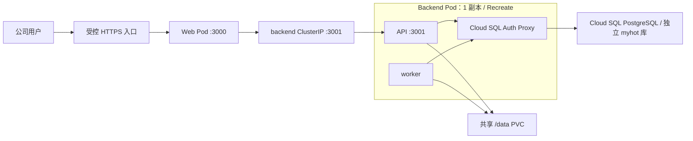

# GCP / GKE 部署方案（参考 Steven）

更新：2026-10-23。状态：**方案与源码核查完成，部署配置待实现，尚未执行 GCP 构建或发布。** 本文对应开发计划中的 OPS-01，首个交付目标是关闭外部动作的内部调试环境。

阶段安排：先按 [MacBook Pro 单机部署说明](macbook-deployment.md)运行，PostgreSQL 原生安装在该 Mac、独立于 Compose；本篇保留为长期 GCP 迁移方案。未来迁移同时覆盖原生数据库的逻辑备份、应用共享文件及私有配置，不只搬运镜像。

建议沿用 Steven 的 Cloud Build → 镜像仓库 → Cloud Deploy / Skaffold → GKE 链路。本项目使用独立的 namespace、发布流水线、数据库和凭据；可在核验容量与权限后复用现有 GCP 项目及集群。`myhot` 沿用当前开发库的技术名称，不代表正式站名已经确定。

## 1. Steven 已提供的参考

以下路径相对于同级 `steven/` 仓库，核查的是当前工作区文件；不等于已经检查线上资源。

| Steven 入口 | 已核实的做法 | 本项目如何采用 |
| --- | --- | --- |
| `Build.yaml` | Cloud Build 构建、推送镜像；默认 `_CREATE_RELEASE=false` | 保留构建与发布分离；本项目先构建一个应用镜像 |
| `scripts/cloud-build-release.sh` | 只有显式 `true` 才创建 Cloud Deploy release；使用提交和构建编号 | 使用独立流水线与固定镜像 digest；不得直接触发 Steven 发布 |
| `skaffold.yaml` | Cloud Deploy 通过 Skaffold 应用 Web / worker 清单 | 用本项目自己的清单和 target；迁移单独执行 |
| `deployment.yaml`、`deploy/k8s/worker.yaml` | 分离角色、单副本 Recreate、退出宽限、健康检查 | 沿用发布原则；退出时间、探针和资源按本项目重新设置 |
| `deploy/k8s/migration-job.yaml` | 单次迁移 Job，与普通 Deployment 分开 | 使用 `node scripts/migrate.ts`；不导入 AI 示例信源 |
| Nacos bootstrap / config-fetcher | init container 下载运行时配置，容器重建后读取新快照 | 首版使用 ConfigMap + Secret；当前项目没有 Steven 的配置加载器，不能只改 Data ID |

Steven 的 `docs/reviews/2026-10-23-cloud-build.md` 记录了项目 `pi-goc-internal` 中的真实构建，`Build.yaml` 配置的 Cloud Deploy 区域是 `us-central1`。该记录明确没有创建 release/rollout。它们可以作为目标选型线索，实际集群、区域、身份、镜像仓库和容量仍需只读核验。

本项目继续使用 **Node.js 24 + npm workspaces**，不复制 Steven 的 Node.js 22 / pnpm 版本。现有 [Dockerfile](../Dockerfile) 已把 Web 构建产物与后端 TypeScript 装入同一镜像；发布时应固定经过验证的 Node 24 补丁版本及基础镜像 digest，并核验目标节点架构。Cloud Deploy 与 Skaffold 的关系见 [Google 官方说明](https://docs.cloud.google.com/deploy/docs/overview)。

## 2. 首版拓扑



图中采用 Cloud SQL 方案；如果已有合适的 GCP PostgreSQL，可复用实例并创建独立数据库与账号，连接方式按该实例调整。

| 角色 | 同一应用镜像的启动命令 | 初始部署 |
| --- | --- | --- |
| Web | `node apps/web/server.ts` | 独立 Deployment，1 副本；只访问 API，不接收数据库、模型密钥或数据卷 |
| API | `node apps/api/src/main.ts` | Backend Pod 中的一个容器；通过 ClusterIP 接收 Web 请求 |
| worker | `node apps/worker/src/main.ts` | Backend Pod 中另一个容器；与 API 共用 `/data`，不开放端口 |
| migrate | `node scripts/migrate.ts` | 单独 Job，与应用使用同一 digest；`parallelism=1`、`completions=1`，失败后检查再重跑 |

API 和 worker 同 Pod 是首版部署选择：它们可以共享一个 RWO 持久化磁盘，减少引入共享文件服务的工作。RWO 的含义是单节点读写，并不保证任意节点的多个 Pod 都能同时挂载。[Kubernetes 卷访问模式](https://kubernetes.io/docs/concepts/storage/persistent-volumes/#access-modes)

代价是 API / worker 共同调度、不能独立扩缩容，后端更新存在停机窗口。这是内部试运行方案。若以后拆成可跨节点调度的独立 Pod，应改用验证过的 RWX 文件系统（例如 Filestore CSI），或先把业务文件访问改为对象存储接口。[GKE Filestore CSI](https://docs.cloud.google.com/kubernetes-engine/docs/how-to/persistent-volumes/filestore-csi-driver)

`/data` 包含上传文件、反馈截图、图片/分享图缓存、站点地图和备份暂存。API 写入的截图会由 worker 读取、转发并删除，不能分别使用独立卷或全部替换为 `emptyDir`。现有代码使用临时文件、重命名及多文件更新，不能直接认为 GCS 挂载与现有文件语义等价。见 [图片处理](../packages/backend/src/media/images.ts)、[反馈](../packages/backend/src/operations/feedback.ts)、[备份](../packages/backend/src/operations/backup.ts)。

## 3. 数据库与配置

### 数据库

- 首选在 GCP 内使用 PostgreSQL 17，与当前开发版本对齐；已有实例能满足要求时复用实例，数据库和用户仍独立于 Steven。局域网开发库 `172.16.0.17:5432` 不默认作为云上数据库。
- 如必须连接局域网库，需要先验证 VPN / Interconnect、双向路由、防火墙、时延和断线恢复。Auth Proxy 不会自动打通局域网。
- 使用 Cloud SQL 时，建议 Auth Proxy + Workload Identity Federation；私网连接还需要正确的 VPC 路径。Google 的该连接方案要求 VPC-native GKE 与实例位于同一 VPC。[官方连接指南](https://docs.cloud.google.com/sql/docs/postgres/connect-kubernetes-engine)
- 在空的验证库上执行全部历史迁移，检查 `pg_trgm`、历史 `default_toast_compression=lz4`、索引及 pg-boss schema 权限；不能只用 `SELECT 1` 证明迁移兼容。历史迁移不直接改写。
- 当前 pg-boss 在运行时初始化 schema / 队列，运行账号不能未经测试就缩减为仅增删改查。测试所需 `CREATEDB` 不等于正式运行必须拥有该权限。
- `DATABASE_POOL_MAX` 只限制业务池，pg-boss 另开最多 4 个连接；按实际 API、worker、迁移、探针和运维连接计算总预算。MS-006 尚未修复前，迁移 Job 的业务池至少为 2。
- 镜像中的 `pg_dump` 主版本应不低于服务器主版本；新库初始化与旧库恢复分别验证。

Auth Proxy 应先完成启动并可连接，再启动 API、worker 或迁移进程；采用原生 sidecar 时通过合适的 startupProbe 保证启动顺序。它还应在应用退出排空期间持续可用；迁移完成后 Job 也必须能结束。实现时核验目标 GKE 对原生 sidecar 的支持及启停顺序，避免代理尚未就绪导致 worker 启动失败、普通代理容器让 Job 一直不完成，或代理先退出导致 worker 排空失败。

### 运行时配置

| 分类 | 主要配置 | 注入位置 |
| --- | --- | --- |
| 公共站点参数 | `SITE_URL`、`AIHOT_RELEASE`、`API_BASE_URL` | ConfigMap；只向需要它的角色提供 |
| 监听地址 | `WEB_HOST=0.0.0.0` / `WEB_PORT=3000`；`API_HOST=0.0.0.0` / `API_PORT=3001` | 各角色单独配置；本地 3100 不需要搬到 GKE |
| 数据库及认证 | 数据库连接、密码、`ADMIN_PASSWORD`、`SESSION_SECRET`、`IMG_PROXY_SIGN_SECRET` | 后端 Secret；不用开发免登录配置 |
| 模型路由 | `LLM_BASE_URL`、`LLM_MODEL`、`LLM_EXTRA_JSON` 及各频道活动配置 | 后端配置；API Key 用 Secret |
| 文件目录 | `AIHOT_DATA_DIR=/data` | API / worker 挂载同一 PVC，并验证非 root 用户写权限 |
| 外部动作 | 下列五个安全阀 | 首轮明确为 `false` |

```dotenv
COLLECT_ENABLED=false
MODEL_CALLS_ENABLED=false
FEISHU_CONTENT_PUSH_ENABLED=false
FEISHU_INTERNAL_ENABLED=false
INDEXNOW_SUBMIT_ENABLED=false
```

所有应用容器使用 `NODE_ENV=production`，内部试运行可另设 `AIHOT_ENVIRONMENT=staging` 作为告警环境名；不设置 `DEV_AUTH_*`，也不打开 `ALLOW_PRIVATE_NETWORK_FETCH`。容器环境变量应按角色列明，不能把完整私有 `.env` 注入 Web。

当前已验证的模型通道为 TokenHub 国际站上的 DeepSeek，见[联调记录](reports/2026-10-23-deepseek-integration.md)。上云需要单独注入凭据，并核对数据库中的活动频道配置和配额。`space_configs` 保存不可变快照，已有频道不会仅因修改环境变量就自动切换模型；新库也应先审阅目标配置，再激活和读回。首轮不调用真实模型。

如后续统一接入 Steven 使用的 Nacos，需要新增本项目自己的配置白名单、下载校验和加载流程，使用独立 Data ID；本方案没有假定这项能力已存在。

## 4. GKE 上线前的适配

1. **入口与访客 IP。** HTTPS 入口只指向 Web，API 使用 ClusterIP 并限制可访问来源。当前 [Web 代理](../apps/web/server.ts) 在 `TRUST_PROXY=true` 时取 X-Forwarded-For 最后一项；Google 外部 Application LB 的最后一项是负载均衡器地址，会使登录/反馈限流把用户归到同一 IP。需按实际代理链归一化头或修正可信代理解析，并测试伪造头；不能只照搬 Compose 的 `TRUST_PROXY=true`。[Google 请求头说明](https://docs.cloud.google.com/load-balancing/docs/https#x-forwarded-for_header)
2. **内部访问。** 首版采用公司已有的私网入口或访问网关，覆盖网站、RSS、公开 API、Agent Markdown 和 MCP。应用的公开内容本身匿名；频道隔离不是用户权限隔离。`SITE_URL` 使用最终访问的 HTTPS 地址，并验证 MCP Host / Origin。
3. **健康检查。** `/api/health` 依赖数据库，适合 readiness；liveness 使用进程级检查，避免数据库短暂失败造成重启风暴。worker 没有 HTTP 端口，可参考 LAN 的本机 hostname + 心跳新鲜度检查；依赖数据库的心跳不直接作为激进重启条件。
4. **退出与副本。** Backend 设置 1 副本、Recreate、`terminationGracePeriodSeconds: 515`，实际验证 worker 最长 470 秒排空。当前 worker 共用一条角色心跳并注册全局排程，不启用 HPA。发布超时需覆盖排空、磁盘重新挂载和启动时间。
5. **源码与镜像。** 补 `.gcloudignore`，在上传前检查文件清单，排除 `.env*` 私有文件、`.data/`、本地凭据、依赖目录和无关工作区内容。`.dockerignore` 只保护 Docker 构建上下文，不证明 Cloud Build 源码上传安全。构建步骤不接收运行时密钥。
6. **网络出口。** 核验私有节点访问官方信源、模型、飞书所需的 DNS / HTTPS 与 NAT / 代理。保留采集器对环回、内网和云元数据地址的阻断，数据库连通不需要放开采集器私网访问。
7. **备份恢复。** Cloud SQL 自动备份 / PITR 与 PVC 快照或文件归档一并设计，并实测恢复。应用现有备份是 S3-compatible / AWS SigV4 上传，不是已完成的原生 GCS / WIF 接入。暂停写入后取得最终数据库与文件备份，记录共同的恢复点。

## 5. 构建与发布顺序

首版使用维护窗口，发布动作由单一流程串行执行；一个 Job 的单副本设置不能阻止两条流水线各启动一个 Job。

1. **核验目标。** 只读检查 GCP 项目、GKE 集群/区域/版本、VPC、ServiceAccount、镜像仓库、PVC StorageClass、数据库和域名。确定使用现有资源或需要创建的资源；暂不假定 Steven 的默认 namespace、账号或配额适用。
2. **准备基础设施。** 配置独立 namespace、身份、Secret、存储、内部入口和数据库。Cloud Deploy 使用独立 pipeline / target；镜像可存入已核验的现有仓库，或独立 Artifact Registry 仓库。不要覆盖 Steven 的资源。
3. **只构建。** 对已核验的源码执行现有类型检查、隔离数据库测试、Web 构建及回归、迁移安全检查；Cloud Build 使用固定版本工具构建一个镜像，记录 digest，先不创建 release。
4. **静默与备份。** 保持外部动作关闭；进入维护状态，阻止新写入并排空停止旧 API / worker，再完成最终数据库和文件备份。连接同一库的本地进程也属于写入方。
5. **迁移与配置。** 使用同一镜像 digest 执行一次迁移 Job；成功后读回迁移记录、频道活动配置及配额，不执行示例 seed。如果 Job 必须挂载同一 RWO PVC，应等待旧 Pod 释放卷，并在新后端启动前释放 Job 的挂载；只需要数据库时不要额外挂载数据卷。
6. **发布。** 迁移成功后才允许 Cloud Deploy 创建 / 执行 rollout，启动新版本 Web 与 Backend。首版普通 Skaffold 清单不包含迁移 Job，防止先启动应用再迁移；后续自动化也必须保留相同顺序。
7. **验收。** 检查实际镜像 digest、健康状态、Pod 重启、Web/API/MCP、各频道出口隔离、文件跨容器可见性与重建持久性、worker 停止日志、备份恢复和安全阀。验收失败时保持关闭外部动作。
8. **逐步启用业务。** 在修复阻断问题、确认业务配置后，先小范围采集，再限定预算启用模型，最后接入已确认的飞书测试目标。每一步单独记录实际请求和投递结果。

如果从旧数据启用非默认频道，还需按[频道说明](multi-space-development.md)单独执行显式身份切换流程；不要把 `space-cutover.ts` 无条件加入每次迁移。镜像回滚不能撤销数据库迁移，切换后也不能回退到不支持多频道的旧版本；恢复方案须与实际 schema 和备份配套。

## 6. 待实现文件与交付证据

下面是计划新增或调整的文件，不是当前可直接执行的部署入口。

| 工作 | 计划位置 | 完成证据 |
| --- | --- | --- |
| Cloud Build 与显式发布脚本 | `Build.yaml`、`scripts/cloud-build-release.sh`、`.gcloudignore` | 真实构建成功、源码清单核对、镜像 digest；构建默认不发布 |
| GKE 运行清单 | `deploy/gke/` 下 namespace、ConfigMap、Web、Backend、Service、PVC、入口清单 | 渲染及 server dry-run，通过 staging 启动和重建验证 |
| Cloud Deploy 连接 | `skaffold.yaml`、独立 pipeline / target 定义 | 目标资源核验、渲染产物及一次成功 rollout |
| 迁移与发布编排 | 单独 migration Job 和发布脚本 | 历史迁移、重复执行、失败中止、排空与停止顺序 |
| 代理与探针适配 | Web 代理、健康检查与相关行为测试 | 正确访客 IP、防伪造、依赖失败不引起重启风暴 |
| 运行手册 | 本文补充实际资源名、发布 / 回退 / 恢复步骤 | 已脱敏的安装、升级、持久化和恢复记录 |

当前 [MS-001～MS-007](known-issues.md) 仍未关闭，其中 MS-001 会使停用频道阻断全局恢复。关闭外部动作的内部部署可用于验证基础设施，但不能因此宣布正式安全响应业务已经验收。正式品牌、官方源、资产影响判断和处置闭环也仍需按[开发计划](development-plan.md)推进。

本次只核查源码、Steven 的构建记录和官方文档，新增方案文档；未创建云资源、上传源码或密钥、运行迁移、发送推送，也未改变本地服务的停止状态。
